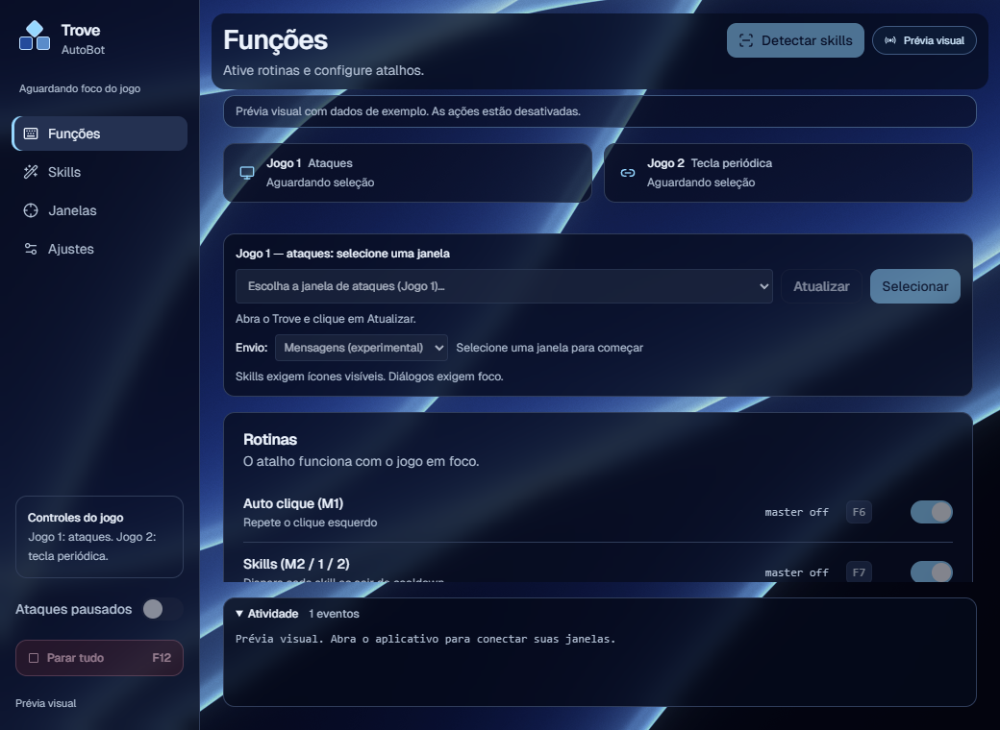
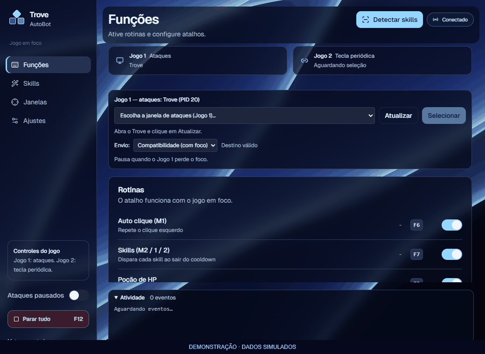

# Trove AutoPilot

Aplicativo Windows que automatiza ações repetitivas no Trove. Controla os ataques de uma janela e envia uma tecla periódica para um segundo processo do jogo.

[Baixar para Windows](https://github.com/Kzinski01/TroveAutoPilot/releases)

## Funcionalidades

| Recurso | Para que serve | Atalho padrão |
|---|---|---|
| Master | Liga ou pausa os ataques do Jogo 1 | F5 |
| Auto clique | Repete cliques ou mantém o botão pressionado | F6 |
| Skills M2, 1 e 2 | Localiza os ícones e usa cada skill ao sair do cooldown | F7 |
| Poção de HP | Usa a poção no intervalo escolhido | F8 |
| Claim e convites | Reconhece diálogos por imagem e executa a ação configurada | F9 |
| Segurar tecla | Segura, solta e repete, com controle próprio | F10 |
| Jogo 2 | Envia uma tecla em intervalos para outro processo | Botão na interface |
| Parar tudo | Desliga as rotinas das duas janelas | F12 |

Os atalhos, teclas e intervalos são configuráveis. A detecção automática encontra os slots sem recortar cada ícone; a calibração do estado **Pronta** é feita uma vez por slot.

## Primeiro uso

Requer Windows 10/11 de 64 bits e Microsoft Edge WebView2 Runtime.

1. Baixe o ZIP da release e extraia a pasta inteira. Mantenha `_internal` e `TroveAutoBot.exe.config` ao lado de `TroveAutoBot.exe`.
2. Abra o aplicativo e o Trove. Selecione a janela em **Jogo 1**.
3. Com a barra de skills visível, clique em **Detectar skills**, no topo. Com cada skill fora do cooldown, clique em **Pronta** no slot correspondente.
4. Ative as rotinas desejadas e pressione **F5** com o jogo em foco.
5. Para usar o **Jogo 2**, selecione outro processo em Funções, ajuste tecla e intervalo e ligue seu controle. Ele funciona mesmo com o master desligado.

Demonstração da interface com dados simulados, sem enviar comandos ao jogo. O botão detecta os três slots; **Pronta** calibra a leitura do cooldown.

Para Claim e convites, capture um trecho com texto ou ícone na aba **Janelas** e configure a ação. As configurações e capturas ficam no seu computador.

## Limites de funcionamento

- **Compatibilidade** pausa ao perder o foco. O modo **Mensagens** é experimental: a aceitação pelo Windows não garante que o Trove execute a ação.
- A leitura das skills exige ícones visíveis. Janelas cobertas ou minimizadas pausam essa leitura.
- **Segurar tecla** e **Jogo 2** têm controles próprios. Use **F12** para desligar todas as rotinas.
- Em Compatibilidade, uma soltura de tecla ou botão pode aguardar o retorno do foco. Se fechar o aplicativo antes disso, pressione e solte fisicamente a tecla ou botão.

Os testes automatizados e o selftest do executável não substituem a [validação com duas instâncias reais](docs/VALIDACAO_MANUAL.md). Projeto independente; o uso de automação pode contrariar as regras do Trove.

## Código e contribuição

O motor usa Python e a interface usa React/Next.js em uma janela WebView2. Para instalar dependências, executar pelo código ou gerar o executável, consulte [Desenvolvimento](docs/DESENVOLVIMENTO.md).

[Contribuir](CONTRIBUTING.md) · [Segurança](SECURITY.md) · [Auditoria](docs/AUDITORIA.md) · [Interface](docs/DESIGN.md)

## Licença

Código próprio sob [MIT](LICENSE). Fontes, dependências e materiais do jogo mantêm seus próprios direitos; veja os [avisos de terceiros](THIRD_PARTY_NOTICES.md).
